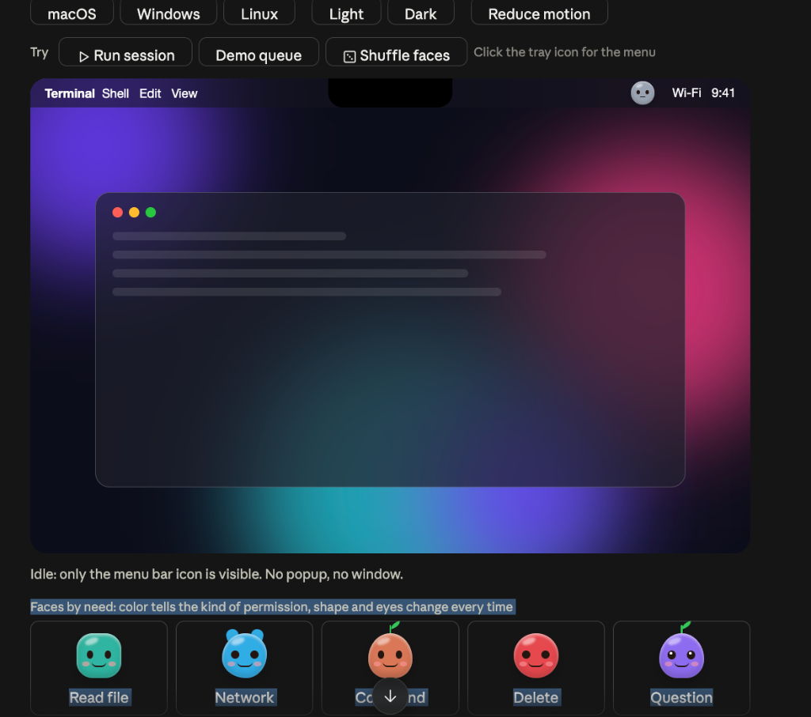
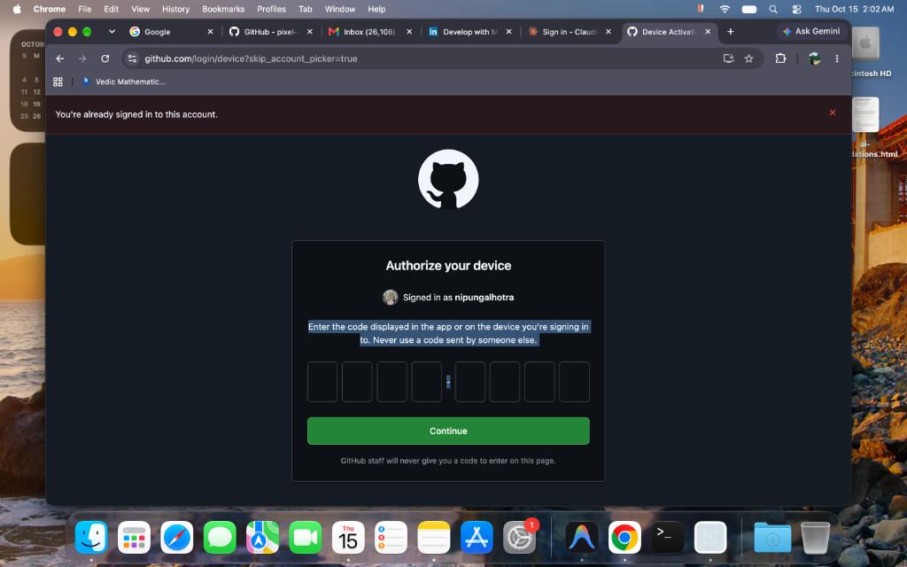

<p align="center">
  
</p>

# 🛡️ loggdin

> **The native macOS Menu Bar security daemon & permission sentinel. Drops down an expressive Liquid Glass permission card centered directly below the MacBook camera notch, featuring Touch ID biometrics, persistent grant caching (10 min / always), and seamless keyboard focus preservation across Claude Code, Antigravity IDE, Cursor, Codex, and terminal shells.**

<p align="center">
  <a href="https://github.com/Louis-CFM/coucou"></a>
  
  
  
  
</p>

---

## 📸 Screenshots & Visual Walkthrough

### 1. Liquid Glass Permission Card (Camera Notch Centered)
When any AI agent attempts a shell command, file write, or external tool execution, **loggdin** slides down smoothly directly centered below your MacBook's camera notch:

<p align="center">
  
</p>

- **Centered Directly Under Camera**: Uses precise `NSScreen.auxiliaryTopLeftArea` / `auxiliaryTopRightArea` geometry and `screen.frame.midX` centering so it never drifts left or right, anchoring right against the notch hardware.
- **Biometric Touch ID**: Tap the Touch ID sensor on your MacBook keyboard to authorize high-risk actions instantly.
- **Expressive Character Face**: Real-time eye-tracking follows your cursor; changes expressions dynamically (idle, thinking, worried on risky commands, pleased on approvals).

---

### 2. Full Management Dashboard & Audit Ledger
Manage active grants, connected agents, and inspect cryptographic Merkle audit records at a glance:

<p align="center">
  
</p>

- **Agent Integrations Hub**: 1-click status and installer for Claude Code, Antigravity IDE, Cursor, Codex CLI, Cowork, and Terminal shells.
- **Cryptographic Audit Ledger**: Tamper-evident Merkle-tree logging of every single decision with hash verification (`/audit/verify`).
- **Active Grants & Rules**: Live countdown timers for 10-minute temporary grants and one-click revocation of permanent rules.

---

## 🌟 Universal AI Agent Compatibility

Modeled after **[Louis-CFM/coucou](https://github.com/Louis-CFM/coucou)**, loggdin implements a dual-transport hook engine (sub-millisecond Unix Domain Socket + HTTP) giving every AI tool its own branded badge, theme colors, and native authorization flow:

| AI Assistant / Tool | Integration Channel | Config Path | What It Guards |
| :--- | :--- | :--- | :--- |
| **🟣 Claude Code** | Native `PermissionRequest` & `PreToolUse` Hooks | `~/.claude/settings.json` | Bash commands, file writes, package installs, `AskUserQuestion` |
| **🔵 Antigravity IDE** | Native Hooks + MCP Schema | `~/.gemini/config/hooks.json` | Terminal executions, file modifications, cloud deployments |
| **🟩 Cursor IDE** | Workspace MCP Server | `~/.cursor/mcp.json` | Autonomous agent execution, background runs, shell tasks |
| **🔷 Codex CLI (OpenAI)** | Native `PermissionRequest` Hook | `~/.codex/hooks.json` | Python runners, dependency installs, shell commands |
| **🟧 Cowork (Claude Desktop)** | Standard MCP Server (`sentinel-mcp`) | `~/Library/Application Support/Claude/claude_desktop_config.json` | Agent file edits, terminal commands, tool executions |
| **🤖 ChatGPT Desktop** | Codex Gateway & Python/Node SDKs | `sdk/sentinel.py` / `sdk/sentinel.js` | Custom LLM function calling, LangChain, OpenAI agent loops |
| **🐙 Copilot CLI** | GitHub Copilot Hook System | `~/.copilot/hooks/sentinel.json` | Pull requests, merges, repository actions, CLI runs |
| **⚡ Terminal Shells (ZSH/Bash)** | Preexec Auto-Gate Hook | `~/.zshrc` | Automatically intercepts `rm -rf`, `sudo`, `git push --force` |

---

## ✨ Key Features & Enhancements

### 🎯 1. Pixel-Perfect Camera Notch Centering
- **Zero Drift**: Calculated from `NSScreen.frame.midX - (width / 2)` and anchored flush beneath the macOS camera housing (`cameraBottomY - 4px`).
- **Multi-Monitor Awareness**: Detects whether the active monitor has a physical camera notch or is an external display, adapting automatically between notch-anchored and floating island styles.

### ⏱️ 2. Smart Scope Selection ("Allow once", "for 10 min", "Always allow")
- **Allow Once (`Space` / Touch ID)**: Permits the single immediate action.
- **Allow for 10 Min (`Tab` to toggle)**: Caches command approval for 10 minutes with auto-expiration, eliminating annoying repetitive prompts during active agent workflows.
- **Always Allow**: Persists command rules to encrypted local storage (`~/.loggdin/rules.json`).
- **Safety Boundary**: Catastrophic root commands (`rm -rf /`, `mkfs`) always require explicit verification and cannot be blindly whitelisted.

### 🔄 3. Simultaneous Multi-Agent Focus Preservation
- When running Claude Code, Antigravity IDE, or Cursor concurrently, loggdin captures the active application state before presenting the card.
- Upon user approval or denial, loggdin automatically activates and returns focus to the calling IDE/terminal without dropping keystrokes or requiring manual mouse clicks.

### 🔒 4. Biometric Touch ID & Hold-to-Confirm
- High-risk operations (e.g., modifying files outside the workspace or executing destructive commands) highlight the card in warm amber/red.
- Complete the action seamlessly by touching the Touch ID sensor or holding the confirm button for 1 second.

---

## 📦 Installation & Packaging

### Option 1: Install Pre-Built DMG
Download the latest `Loggdin.dmg` and drag `Loggdin.app` to `/Applications`:
```bash
./packaging/create_dmg.sh
open dist/Loggdin.dmg
```

### Option 2: Build from Source
```bash
git clone https://github.com/nipun/loggdin.git
cd loggdin
swift build -c release
cp .build/release/loggdin /Applications/Loggdin.app/Contents/MacOS/loggdin
```

---

## 🚀 1-Click Setup Across All AI Agents

Configure all supported AI agents in one command:

```bash
loggdin install all
```

Output:
```
🚀 Setting up loggdin across all AI agents and environments...
🟣 Configuring Claude Code native hooks & Claude Desktop (Cowork)...
✓ Registered Claude Code native hooks in ~/.claude/settings.json
🔵 Configuring Antigravity & Antigravity IDE...
✓ Registered Antigravity hooks in ~/.gemini/config/hooks.json
🟩 Configuring Cursor...
✓ Updated ~/.cursor/mcp.json
🔷 Configuring Codex & ChatGPT hooks...
✓ Updated ~/.codex/hooks.json
⚡ Installing ZSH Shell Auto-Gate Hook...
✓ Added hook to ~/.zshrc
🎉 All integrations installed successfully!
```

---

## 🧪 Testing the Live Notch Popup

Trigger test prompts for different AI assistants:

```bash
# Test Claude Code permission prompt
loggdin test claude

# Test Google Antigravity cloud deployment prompt
loggdin test antigravity

# Test Cursor force push prompt
loggdin test cursor

# Test OpenAI Codex dependency install prompt
loggdin test codex
```

---

## 🛠️ CLI Reference

```bash
# Intercept and guard any command in the shell
loggdin run <command...>

# Start the MCP server for Claude, Cursor, Antigravity
loggdin mcp

# Inspect daemon health, active grants, and socket status
loggdin status

# Verify tamper-proof cryptographic audit trail
curl http://localhost:9191/audit/verify
```

---

## 🧩 SDK Usage (Custom Python & Node.js Agents)

### Python SDK (`sdk/sentinel.py`)
```python
from sentinel import ask_permission, guard

# Ask user authorization before critical action
if ask_permission("rm -rf ./build", requested_by="ChatGPT", risk="high"):
    print("User approved via notch card! Running cleanup...")

# Or automatically guard command execution
result = guard("git push origin main --force", requested_by="Codex")
```

### Node.js SDK (`sdk/sentinel.js`)
```javascript
const { askPermission } = require('./sentinel');

async function run() {
  const allowed = await askPermission({
    command: 'npm publish --access public',
    requestedBy: 'Claude Code',
    risk: 'medium'
  });
  if (allowed) console.log("Published with user consent!");
}
run();
```

---

## 📜 Credits & License

- Built natively in Swift 6, SwiftUI, and AppKit for macOS Sequoia (14+).
- Architecture inspired by **[Louis-CFM/coucou](https://github.com/Louis-CFM/coucou)**.
- Licensed under the **MIT License**.
