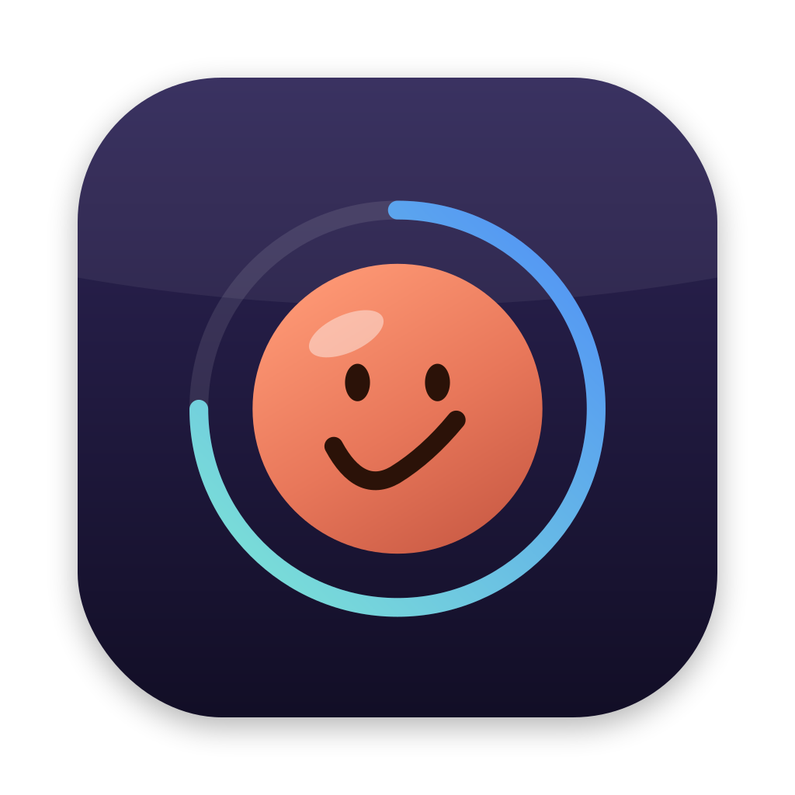
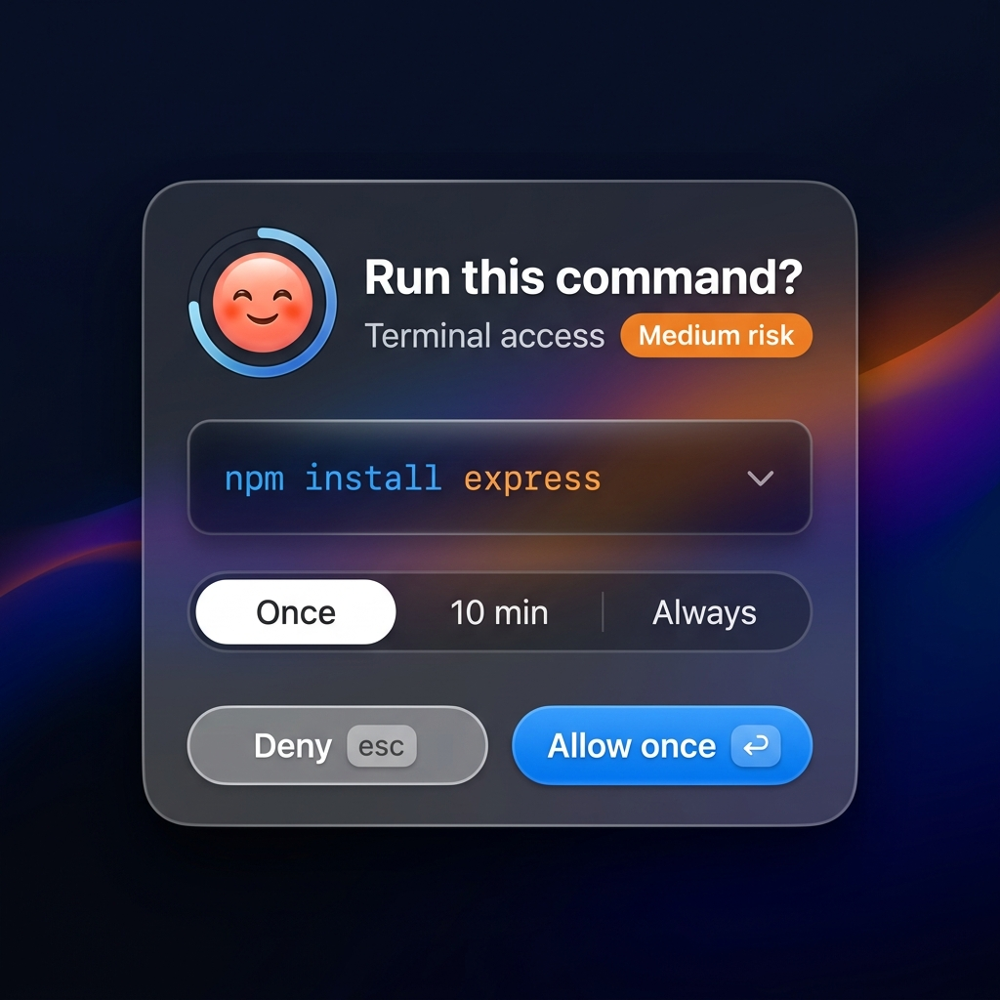
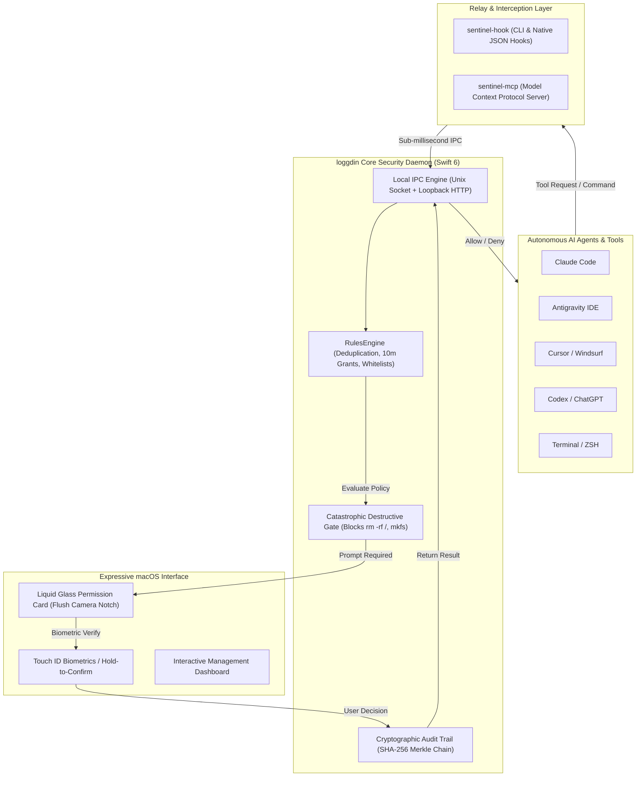

<p align="center">
  
</p>
<p align="center">
  
</p>

# 🛡️ loggdin

> **The native macOS Menu Bar security daemon & permission sentinel. Drops down an expressive Liquid Glass permission card centered directly below the MacBook camera notch, featuring Touch ID biometrics, persistent grant caching (10 min / always), and seamless keyboard focus preservation across Claude Code, Antigravity IDE, Cursor, Codex, and terminal shells.**

<p align="center">
  <a href="https://github.com/Louis-CFM/coucou"></a>
  
  
  
  
</p>

---

## 🌟 Universal AI Agent Compatibility

Modeled after **[Louis-CFM/coucou](https://github.com/Louis-CFM/coucou)**, loggdin implements a dual-transport hook engine (sub-millisecond Unix Domain Socket + HTTP) giving every AI tool its own branded badge, theme colors, and native authorization flow:

| AI Assistant / Tool | Integration Channel | Config Path | What It Guards |
| :--- | :--- | :--- | :--- |
| **🟣 Claude Code** | Native `PermissionRequest` & `PreToolUse` Hooks | `~/.claude/settings.json` | Bash commands, file writes, package installs, `AskUserQuestion` |
| **🔵 Antigravity IDE** | Native Hooks + MCP Schema | `~/.gemini/config/hooks.json` | Terminal executions, file modifications, cloud deployments |
| **🟩 Cursor IDE** | Workspace MCP Server | `~/.cursor/mcp.json` | Autonomous agent execution, background runs, shell tasks |
| **🔷 Codex CLI (OpenAI)** | Native `PermissionRequest` Hook | `~/.codex/hooks.json` | Python runners, dependency installs, shell commands |
| **🟧 Cowork (Claude Desktop)** | Standard MCP Server (`sentinel-mcp`) | `~/Library/Application Support/Claude/claude_desktop_config.json` | Agent file edits, terminal commands, tool executions |
| **🤖 ChatGPT Desktop** | Codex Gateway & Python/Node SDKs | `sdk/sentinel.py` / `sdk/sentinel.js` | Custom LLM function calling, LangChain, OpenAI agent loops |
| **🐙 Copilot CLI** | GitHub Copilot Hook System | `~/.copilot/hooks/sentinel.json` | Pull requests, merges, repository actions, CLI runs |
| **⚡ Terminal Shells (ZSH/Bash)** | Preexec Auto-Gate Hook | `~/.zshrc` | Automatically intercepts `rm -rf`, `sudo`, `git push --force` |

---

## ✨ Key Features & Enhancements

### 🎯 1. Pixel-Perfect Camera Notch Centering
- **Zero Drift**: Calculated from `NSScreen.frame.midX - (width / 2)` and anchored flush beneath the macOS camera housing (`cameraBottomY - 4px`).
- **Multi-Monitor Awareness**: Detects whether the active monitor has a physical camera notch or is an external display, adapting automatically between notch-anchored and floating island styles.

### ⏱️ 2. Smart Scope Selection ("Allow once", "for 10 min", "Always allow")
- **Allow Once (`Space` / Touch ID)**: Permits the single immediate action.
- **Allow for 10 Min (`Tab` to toggle)**: Caches command approval for 10 minutes with auto-expiration, eliminating annoying repetitive prompts during active agent workflows.
- **Always Allow**: Persists command rules to encrypted local storage (`~/.loggdin/rules.json`).
- **Safety Boundary**: Catastrophic root commands (`rm -rf /`, `mkfs`) always require explicit verification and cannot be blindly whitelisted.

### 🔄 3. Simultaneous Multi-Agent Focus Preservation
- When running Claude Code, Antigravity IDE, or Cursor concurrently, loggdin captures the active application state before presenting the card.
- Upon user approval or denial, loggdin automatically activates and returns focus to the calling IDE/terminal without dropping keystrokes or requiring manual mouse clicks.

### 🔒 4. Biometric Touch ID & Hold-to-Confirm
- High-risk operations (e.g., modifying files outside the workspace or executing destructive commands) highlight the card in warm amber/red.
- Complete the action seamlessly by touching the Touch ID sensor or holding the confirm button for 1 second.

---

## 📦 Installation & Packaging

### Option 1: Install Pre-Built DMG
Download the latest `Loggdin.dmg` and drag `Loggdin.app` to `/Applications`:
```bash
./packaging/create_dmg.sh
open dist/Loggdin.dmg
```

### Option 2: Build from Source
```bash
git clone https://github.com/nipun/loggdin.git
cd loggdin
swift build -c release
cp .build/release/loggdin /Applications/Loggdin.app/Contents/MacOS/loggdin
```

---

## 🚀 1-Click Setup Across All AI Agents

Configure all supported AI agents in one command:

```bash
loggdin install all
```

Output:
```
🚀 Setting up loggdin across all AI agents and environments...
🟣 Configuring Claude Code native hooks & Claude Desktop (Cowork)...
✓ Registered Claude Code native hooks in ~/.claude/settings.json
🔵 Configuring Antigravity & Antigravity IDE...
✓ Registered Antigravity hooks in ~/.gemini/config/hooks.json
🟩 Configuring Cursor...
✓ Updated ~/.cursor/mcp.json
🔷 Configuring Codex & ChatGPT hooks...
✓ Updated ~/.codex/hooks.json
⚡ Installing ZSH Shell Auto-Gate Hook...
✓ Added hook to ~/.zshrc
🎉 All integrations installed successfully!
```

---

## 🧪 Testing the Live Notch Popup

Trigger test prompts for different AI assistants:

```bash
# Test Claude Code permission prompt
loggdin test claude

# Test Google Antigravity cloud deployment prompt
loggdin test antigravity

# Test Cursor force push prompt
loggdin test cursor

# Test OpenAI Codex dependency install prompt
loggdin test codex
```

---

---

## 🏛️ System Architecture & Workflow



---

## 💡 Real-World Use Cases

### 1. Autonomous Agent Terminal Gating (LangChain, AutoGPT & CrewAI)
Autonomous agents frequently iterate through shell commands (`git commit`, `npm install`, `pip install`). When an agent attempts an unexpected high-risk command (e.g. `docker compose down -v` or `rm -rf`), loggdin immediately pauses execution and drops down the notch permission card.
- **Operator Advantage**: You can grant **10 minutes** of authorization for iterative steps or reject suspicious actions with zero context switching.

### 2. Workspace Jail & Out-of-Tree File Protection
Agents occasionally hallucinate paths or try writing files to parent directories (`/etc`, `~/.ssh`, `~/.aws/credentials`). loggdin detects out-of-workspace file writes, triggers a warning state on the notch card, and requires Touch ID before any file outside the active project can be modified.

### 3. Focus-Preserving Multi-Agent Development
When running multiple coding assistants simultaneously (e.g., Claude Code in iTerm and Antigravity IDE on an external monitor), approving an action in loggdin instantly restores keyboard focus back to the exact window and cursor location where you were typing, avoiding focus loss.

### 4. Time Machine Rollbacks for Dangerous Edits
Before approving any file modification tool call, loggdin captures a localized file state snapshot. If an agent ruins your file, open the loggdin dashboard and click **Undo** to instantly restore the original file contents.

### 5. Centralized Compliance & Merkle Audit Trail
All security decisions are permanently logged to `~/.loggdin/audit_log.json` and chained together using cryptographic SHA-256 hashes. You can mathematically verify whether any audit entry has been altered, deleted, or tampered with:
```bash
curl http://localhost:9191/audit/verify
# {"isValid": true, "totalEntries": 42, "message": "Audit chain intact"}
```

---

## 🛠️ CLI Reference

| Command | Description |
| :--- | :--- |
| `loggdin status` | Inspect daemon health, active port, socket path, and running grants. |
| `loggdin run <cmd>` | Execute a command protected by the notch permission gate. |
| `loggdin mcp` | Launch the Model Context Protocol stdio server for AI agents. |
| `loggdin dashboard` | Open the native SwiftUI monitoring and rules dashboard. |
| `loggdin rules list` | Display all persistent whitelist and blacklist rules. |
| `loggdin rules add <pattern>` | Add a command pattern to the permanent whitelist. |
| `loggdin grants list` | List active 10-minute temporary authorizations with time remaining. |
| `loggdin grants revoke <id>` | Immediately revoke an active grant. |
| `loggdin install <agent\|all>` | Install native hooks across Claude Code, Antigravity, Cursor, Codex, or all. |
| `loggdin uninstall <agent\|all>` | Cleanly remove hooks and restore original configuration files. |
| `loggdin test <agent>` | Trigger a live demo permission prompt on your screen. |

---

## 🧩 SDK Documentation & Examples

Comprehensive SDK documentation, quickstarts, and integration guides are available in **[`sdk/README.md`](sdk/README.md)**.

### Python Quickstart (`sdk/sentinel.py` / `sdk/loggdin.py`)
```python
from sentinel import ask_permission, guard

# Safe list-based execution prevents command injection
result = guard(["git", "push", "origin", "main", "--force"], requested_by="Release Bot")
print(result.stdout)
```

### Node.js Quickstart (`sdk/sentinel.js`)
```javascript
const { askPermission, guard } = require('./sentinel');

async function run() {
  const allowed = await askPermission({
    command: 'docker compose down -v',
    requestedBy: 'Antigravity Agent',
    risk: 'high'
  });
  if (allowed) console.log("Authorized by operator!");
}
run();
```

---

## ❓ Troubleshooting & FAQs

### Q: Port 9191 is already in use by another service
**A**: loggdin dynamically detects port conflicts. You can customize the port via environment variables or auto-discovery:
```bash
export LOGGDIN_PORT=9292
loggdin status
```
The active port is automatically written to `~/.loggdin/port` and read by all SDKs.

### Q: How do I test the permission card without running an agent?
**A**: Run the built-in test trigger:
```bash
loggdin test antigravity
```
Look up at your MacBook camera notch — the Liquid Glass card will drop down immediately!

### Q: macOS Gatekeeper reports the app is untrusted
**A**: `packaging/create_dmg.sh` includes automatic ad-hoc or Developer ID code signing:
```bash
./packaging/create_dmg.sh
```

---

## 🧪 Automated Testing & CI/CD

loggdin includes an automated test suite across 6 test suites covering security, persistence, packaging, and protocols:

```bash
# Run all automated tests
./tests/run_all.sh
```

| Test Suite | File | What It Validates |
| :--- | :--- | :--- |
| **Packaging & Portability** | `tests/test_packaging_integrity.sh` | Zero hardcoded user paths, shell & Node script syntax, Homebrew Cask supply chain |
| **RulesEngine & Merkle Chain** | `tests/test_rules_engine_logic.py` | Pipeline command splitting (`&&`, `;`, `||`), destructive command traps, Merkle chain tampering |
| **Component Robustness** | `tests/test_components_robustness.py` | Atomic persistence, corrupt config recovery (`.corrupt.<ts>.json`), deduplication, grant expiration, ZSH marker boundaries |
| **Python SDK** | `tests/test_sdk_python.py` | `ask_permission()`, safe `guard()` (list arguments & `shell=False`), dynamic port discovery |
| **Node.js SDK** | `tests/test_sdk_node.js` | `askPermission()`, `guard()` (execFile array execution), dynamic port discovery |
| **MCP Server Protocol** | `tests/test_mcp_server.py` | JSON-RPC 2.0 handshake (`initialize`, `tools/list`, and `tools/call`) |

---

## 🛡️ Production Error Handling & Logging

### Atomic Persistence & Crash Recovery
- **Atomic File Writes**: Configuration files (`rules.json`, `grants.json`, `audit_log.json`) are written using `.atomic` mode to prevent corruption during unexpected shutdowns.
- **Corrupt File Defense**: If a configuration file is corrupted, `RulesEngine` automatically preserves a timestamped copy (`rules.corrupt.<timestamp>.json`) and logs diagnostics rather than silently discarding user policies.
- **Atomic Shell Backups**: Modifying `~/.zshrc` creates an atomic timestamped backup (`~/.zshrc.bak.<timestamp>`) and wraps injections in strict boundary markers (`# >>> loggdin hook start >>>`).

### Structured Logging
All background operations emit structured diagnostic logs with clear subsystem prefixes:
- `[loggdin]`: Single-instance mutex, URL scheme dispatch, socket binding.
- `[HookInstaller]`: Per-agent hook deployment, configuration parsing, symlink status.
- `[RulesEngine]`: Rule evaluation, active grant caching, Merkle chain computation.

### SDK Injection Defense
- Both Python (`sdk/sentinel.py`) and Node.js (`sdk/sentinel.js`) SDKs support argument lists (`["git", "push"]`) to execute commands with `shell=False` or `execFile`, eliminating shell injection risks.

---

## 📜 Credits & License

- Built natively in Swift 6, SwiftUI, and AppKit for macOS Sequoia (14+).
- Architecture inspired by **[Louis-CFM/coucou](https://github.com/Louis-CFM/coucou)**.
- Licensed under the **MIT License**.
